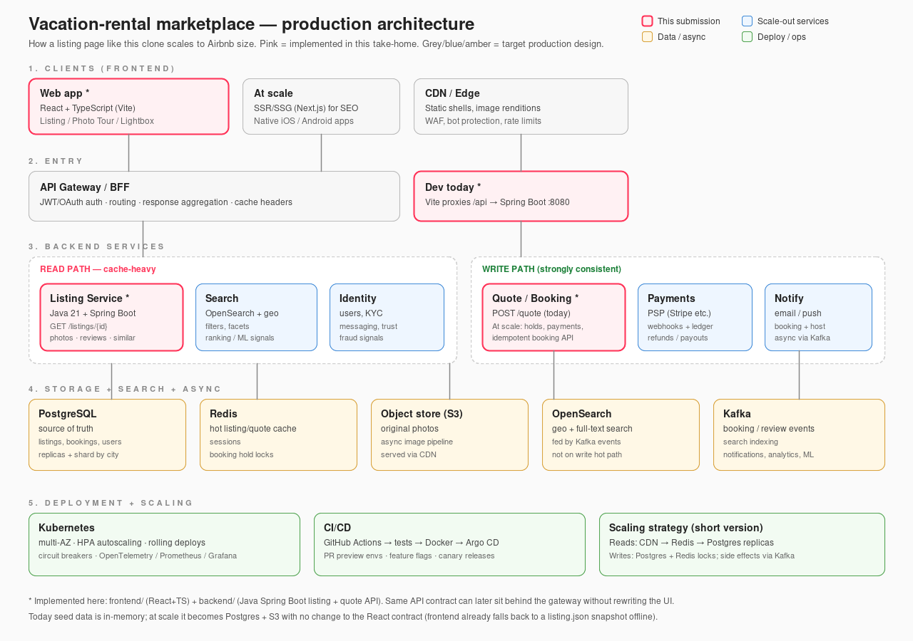

# Production Architecture — Vacation-Rental Marketplace

> The take-home implements the **listing read path + quote** slice
> (React UI + Java Spring Boot API). The diagram shows how that slice
> fits into a full Airbnb-scale marketplace without rewriting the UI.

## What the diagram is arguing

1. **Frontend** — React listing page today; at scale: CDN-cached SSR shells + native apps.
2. **Backend** — domain services behind a gateway (Listing, Search, Identity, Booking/Quote, Payments, Notify).
3. **Storage** — Postgres as source of truth, Redis for hot reads + booking locks, S3 for photos.
4. **Search** — OpenSearch, fed asynchronously from Kafka (kept off the booking hot path).
5. **Deployment** — Kubernetes + HPA, GitHub Actions → Docker → Argo CD, canary / feature flags.

## Scaling strategy (short)

| Concern | Approach |
|---|---|
| Listing pages (read-heavy) | CDN → Redis → Postgres replicas. Immutable listing JSON is cache-friendly. |
| Booking / quote writes | Strong consistency in Postgres; Redis locks for holds; idempotent APIs. |
| Search | Async index via Kafka — never block a booking on OpenSearch. |
| Photos | S3 originals → async renditions → CDN (UI only requests sized URLs). |
| Scale-out | Stateless pods on Kubernetes (HPA); shard Postgres by city when needed. |

## Today vs production

| Layer | This repo | At scale |
|---|---|---|
| Frontend | Vite + React + TS | SSR/SSG + CDN + mobile apps |
| Backend | Spring Boot: `/listings/{id}`, `/quote` | Gateway + Listing / Booking / Search / Identity services |
| Storage | In-memory seed + same API contract | Postgres + Redis + S3 |
| Search | Single listing (no catalog search) | OpenSearch + geo / facets / ranking |
| Deploy | `mvn` + `npm` locally | K8s, CI/CD, observability |

## Why this shape

- **Read/write split** is the main production lesson for marketplaces: cache reads hard, keep writes correct.
- **Contract-first API** — the React app already ships a `listing.json` snapshot of the Java payload, so swapping the seed for Postgres later does not rewrite the UI.
- **Keep the take-home honest** — pink boxes mark what was actually built; everything else is the scale-out plan reviewers asked for.
